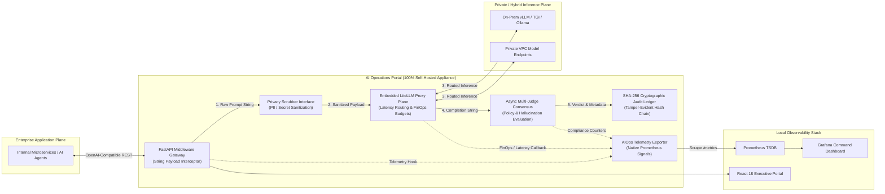

# 🛡️ AI Operations Portal (`ai-operations-portal`)

> **Self-Hosted Enterprise AI Governance, FinOps, Data Sovereignty & AIOps Command Center — Application-Layer Middleware with Pluggable LiteLLM Routing, Async Multi-Judge Consensus, Prometheus Telemetry, AEGIS Copilot & SHA-256 Audit Ledger.**

[](https://python.org)
[](https://fastapi.tiangolo.com)
[]()
[]()
[]()
[-F59E0B?style=flat-square)](LICENSE)
[-64748B?style=flat-square)](#solo-maintained-portfolio--contribution-policy)
[-0A66C2?style=flat-square&logo=linkedin)](https://www.linkedin.com/in/marian-rop)

## Architectural Executive Overview

**AI Operations Portal** is a **100% self-hosted, cloud-agnostic, downloadable enterprise appliance** and Universal Command Center designed to monitor, govern, and optimize production AI pipelines. Engineered specifically for strict deployment inside **private network perimeters, standalone Docker/Podman containers, and air-gapped Kubernetes environments (K3s / Red Hat OpenShift)**, the platform operates with zero external SaaS dependencies or third-party telemetry leaks.

By design, `ai-operations-portal` **does not manage underlying hardware, GPU clusters, or infrastructure provisioning**. Instead, it acts as a high-throughput, low-latency **Application-Layer Governance Middleware** that intercepts raw string payloads (inbound prompts and outbound model completions) routed through an embedded **LiteLLM proxy plane**, bridging the gap between raw text generation and enterprise operational reliability (**AIOps, FinOps, Data Sovereignty, and Cryptographic Compliance**).

---

## 📑 Table of Contents (Index)

- [Architectural Executive Overview](#architectural-executive-overview)
- [Core Operational Pillars](#core-operational-pillars)
- [System Architecture & Data Flow Blueprint](#system-architecture--data-flow-blueprint)
- [Repository Structure](#repository-structure)
- [Deployment Topologies & Pluggable LiteLLM](#deployment-topologies--pluggable-litellm)
- [Automated Unit Tests & Live API Verification](#automated-unit-tests--live-api-verification)
- [Live Workbench, Telemetry & Execution Proofs (`prtscr&logs/`)](#live-workbench-telemetry--execution-proofs-prtscrlogs)
- [Enterprise Extensions & Plugin Architecture](#enterprise-extensions--plugin-architecture)
- [Solo-Maintained Portfolio & Contribution Policy](#solo-maintained-portfolio--contribution-policy)

---

## Core Operational Pillars

### 1. FinOps & Autonomous Cost Governance
- **Granular Token Accounting**: Intercepts and calculates real-time prompt/completion token consumption across heterogeneous LLM backends (local vLLM/Ollama endpoints, private OpenAI-compatible gateways, or hybrid inference pools).
- **Dynamic Budget Enforcement**: Enforces hard and soft ceiling budgets per tenant, department, or application key with automated fallback routing before cost overruns occur.
- **Latency-Aware Model Routing**: Leverages the embedded LiteLLM routing plane to dynamically shift traffic to the most cost-effective and lowest-latency model endpoint meeting SLA thresholds.

### 2. Data Sovereignty & Zero-Trust Privacy
- **In-Transit Payload Sanitization**: Inspects application-level string payloads prior to upstream model dispatch, ensuring sensitive corporate intellectual property, PII, credentials, and regulated entities never leave the private network perimeter.
- **Deterministic Token Vaulting & Re-Hydration**: Supports bidirectional pseudonymization markers so downstream business applications receive coherent responses without exposing raw identifiers to inference engines.
- **Air-Gapped Residency Guarantee**: All scrubbing, policy evaluation, and caching occur strictly in-memory or within local perimeter storage volumes.

### 3. AIOps Telemetry & Pipeline Observability
- **Native Prometheus Exposition**: Exports high-cardinality operational metrics (`/metrics`) including Time-To-First-Token (TTFT), end-to-end request latency histograms, token throughput rates, active concurrency gauges, and upstream provider failure ratios.
- **Runtime Process & Saturation Signals**: Correlates application-layer LLM pipeline performance with container-level memory, CPU, and file-descriptor saturation via `psutil` instrumentation.
- **Turnkey Grafana Dashboards**: Ships with pre-wired Prometheus scraping rules and Grafana visualization provisioning for immediate NOC/SOC visibility.

### 4. Cryptographic Audit Trails & Multi-Judge Governance
- **Asynchronous Multi-Judge Consensus**: Evaluates prompt/completion pairs against hallucination, toxicity, prompt-injection, and regulatory compliance policies using an asynchronous multi-judge voting architecture that avoids blocking critical-path inference latency.
- **SHA-256 Tamper-Evident Chaining**: Records every intercepted transaction, scrubbing action, and compliance verdict into an immutable hash-chained ledger (`prev_hash + payload_digest + timestamp`), providing mathematically verifiable non-repudiation for internal auditors and external regulators (SOC2, ISO 42001, EU AI Act, HIPAA).

---

## System Architecture & Data Flow Blueprint



---

## Repository Structure

```text
ai-operations-portal/
├── backend/
│   ├── src/
│   │   ├── main.py                  # FastAPI governance gateway & SPA server
│   │   ├── plugin_loader.py         # Dynamic Open-Core / Enterprise entry_points loader
│   │   ├── privacy_scrubber.py      # Abstract privacy contract + Open-Core shell
│   │   ├── compliance_judges.py     # Abstract async multi-judge contract + shell
│   │   ├── audit_ledger.py          # Abstract SHA-256 hash-chain contract + shell
│   │   ├── aiops_metrics.py         # Prometheus /metrics & psutil runtime saturation
│   │   ├── litellm_bridge.py        # Pluggable LiteLLM catalog & routing bridge
│   │   ├── portal_assistant.py      # AEGIS dual-mode (Normal / SME) concierge
│   │   └── security_guard.py        # 3-tier access policy, CSPRNG key & rate shield
│   ├── tests/
│   │   └── test_open_core_plugin_loader.py  # Automated contract & security tests
│   ├── config.yaml                  # LiteLLM routing, FinOps caps & Prometheus hooks
│   └── requirements.txt
├── frontend/
│   ├── src/
│   │   ├── components/              # Workflow, FinOps, Security, Compliance, Stress & AEGIS
│   │   └── App.jsx                  # React 18 + Tailwind Executive Portal
│   └── public/images/               # Portal & AEGIS UI assets
├── deploy/
│   ├── docker-compose.yml           # App + Prometheus + Grafana stack
│   ├── k8s/deployment.yaml          # Hardened K3s / OpenShift non-root manifest
│   └── deploy_cloudrun.sh           # Cap-enforced Cloud Run deploy script
├── prtscr&logs/
│   ├── 01_health_and_edition.md ... 06_unit_test_suite_verification.md
│   └── pictures/                    # 6 HD UI, FinOps, Privacy, Jury & AIOps captures
├── Dockerfile                       # Root non-root (UID 1001:0) container build
└── README.md
```

---

## Deployment Topologies & Pluggable LiteLLM

### Pluggable LiteLLM Gateway (`.env` Driven)
Point the portal at **any** local, cluster, or cloud LiteLLM proxy via environment variables (no code changes needed):
```bash
LITELLM_PROXY_MODE=auto                                      # auto | live | local-mock-fallback
LITELLM_PROXY_URL=http://127.0.0.1:4001/v1                   # Any OpenAI-compatible LiteLLM URL
LITELLM_API_KEY=sk-your-litellm-key
LITELLM_DEFAULT_MODEL=gemini-3.8-flash
LITELLM_DEFAULT_JUDGES=gemini-3.8-flash,ministral-14b-latest,nvidia/nemotron-3.5-lightning-30b-a3b
```

### 1. Google Cloud Run (1-Command Stateless Public Demo or Private VPC)
The root `Dockerfile` bundles FastAPI + React 18 UI into a single non-root container (`USER 1001:0`) honoring `${PORT}`:
```bash
gcloud run deploy ai-operations-portal \
  --source . \
  --region europe-west1 \
  --allow-unauthenticated
```

### 2. Universal Kubernetes (K3s, GKE, EKS, AKS, Rancher & Red Hat OpenShift)
```bash
kubectl apply -f deploy/k8s/deployment.yaml
```
- Runs `non-root` (`UID 1001`, group `0`), drops all Linux capabilities, exposes `/health` probes and native `/metrics` Prometheus annotations.

### 3. Docker / Podman Compose Appliance (App + Prometheus + Grafana)
```bash
./run_local.sh
```

---

## Automated Unit Tests & Live API Verification

### 1. Run the Backend Regression & Security Test Suite
Validates standalone Open-Core plugin isolation (`AI_PORTAL_EDITION=open-core`), health/edition/metrics/SPA endpoints, AEGIS dual-mode (`normal` vs. `sme`) responses, and CSPRNG `PORTAL_MASTER_KEY` protection:
```bash
cd backend
../venv/bin/python -m unittest discover -s tests -v
```

### 2. Live `cURL` Governance & AIOps Verification
```bash
# Health, Plugin Edition & LiteLLM Catalog
curl -s http://localhost:8000/health | jq .
curl -s http://localhost:8000/api/v1/edition | jq .
curl -s http://localhost:8000/api/v1/models | jq .

# OpenAI-Compatible Payload Interception (Scrubber -> LiteLLM -> Multi-Judge -> SHA-256 Ledger)
curl -s -X POST http://localhost:8000/v1/chat/completions \
  -H "Content-Type: application/json" \
  -d '{
    "model": "gemini-3.8-flash",
    "tenant_id": "hospital-eu-01",
    "selected_judges": ["gemini-3.8-flash", "ministral-14b-latest"],
    "messages": [{"role": "user", "content": "Patient Elena Rostova (MRN-994821) paid copay with card 4532-8910-2234-7788. Draft concise discharge instructions."}]
  }' | jq .

# Audit Ledger & Native Prometheus Telemetry
curl -s http://localhost:8000/api/v1/ledger | jq .
curl -s http://localhost:8000/metrics | grep ai_portal_
```

---

## Live Workbench, Telemetry & Execution Proofs (`prtscr&logs/`)

### 📝 Recorded Live Execution & Test Logs (`prtscr&logs/`)
Every Markdown log below contains exact `cURL` commands, request payloads, and live JSON / Prometheus / `unittest` output captured from the portal runtime:

1. [**System Health & Plugin Edition Discovery**](prtscr%26logs/01_health_and_edition.md) — `GET /health` · `GET /api/v1/edition`
2. [**Dynamic LiteLLM Catalog & 3-Tier GDPR Access Control**](prtscr%26logs/02_models_and_auth_tier.md) — `GET /api/v1/models` · `GET /api/v1/auth/tier`
3. [**Governed OpenAI-Compatible Chat Completion Pipeline**](prtscr%26logs/03_governed_chat_completion.md) — `POST /v1/chat/completions`
4. [**AEGIS Dual-Mode Governance Concierge (Normal vs. CISO SME)**](prtscr%26logs/04_aegis_assistant_normal_and_sme.md) — `POST /api/v1/assistant/chat`
5. [**SHA-256 Audit Ledger & Prometheus `/metrics` AIOps Telemetry**](prtscr%26logs/05_audit_ledger_and_prometheus_metrics.md) — `GET /api/v1/ledger` · `GET /metrics`
6. [**Automated Backend Unit Test Suite Verification (`4/4 OK`)**](prtscr%26logs/06_unit_test_suite_verification.md) — `unittest discover -s tests -v`

### 🖼️ Portal UI, FinOps, Privacy Vault, Jury & AIOps Gallery (`prtscr&logs/pictures/`)

<details open>
<summary><b>Click here to view the 6 Full-HD Portal UI, FinOps, Privacy Vault, Multi-Judge & AIOps Telemetry Captures (<code>prtscr&logs/pictures/</code>)</b></summary>
<br>

<div align="center">
  
  
  
  
  
  
</div>

</details>

- 📂 **Direct link to proofs & screenshots:** [`prtscr&logs/`](prtscr%26logs/) · [`prtscr&logs/pictures/`](prtscr%26logs/pictures/)

---

## Enterprise Extensions & Plugin Architecture

This repository provides the **Source-Available Core Appliance (`All Rights Reserved — Portfolio & Evaluation Only`)**, including the public FastAPI interceptor gateway, dynamic plugin loader (`backend/src/plugin_loader.py`), native Prometheus AIOps telemetry hooks, agnostic LiteLLM FinOps configuration, and executive React 18 UI shell.

### How Open-Core & Private Enterprise Plugins Connect
At startup, `plugin_loader.py` inspects Python `entry_points(group="ai_portal.plugins")` and `/app/plugins` (`AI_PORTAL_PLUGINS_DIR`):
- **Standalone Evaluation Mode (Default):** Runs out-of-the-box with zero private dependencies using `OpenCorePassthroughScrubber`, `MockAsyncJudgeCouncil`, `EphemeralSHA256Ledger`, and `AbstractAnomalyPredictor` (`GET /api/v1/edition` → `"edition": "open-core"`).
- **Enterprise Mode (Private Extension Attached):** Automatically hot-swaps in proprietary plugins implementing the abstract base contracts (`GET /api/v1/edition` → `"edition": "enterprise"`) and mounts private FastAPI routers:
  - **Universal Context-Aware Scrubbers (`BasePrivacyScrubber`)**: High-speed NER/regex-hybrid sanitization engines, domain-specific financial/healthcare redaction ontologies, and reversible HMAC cryptographic token vaults.
  - **Production Multi-Judge Consensus Engines (`BaseComplianceJudgeCouncil`)**: Calibrated small-language-model (SLM) judge ensembles, deterministic guardrails, and sub-15ms asynchronous policy arbitration.
  - **Hardware-Backed & Persistent Secure Ledgers (`BaseAuditLedger`)**: Durable hash-chained SQLite/WORM storage sinks, cryptographic block signing, and automated regulatory attestation exporters.

---

## Solo-Maintained Portfolio & Contribution Policy

- **License (`All Rights Reserved — Portfolio & Evaluation Only`):** See [`LICENSE`](LICENSE). Engineering leaders, recruiters, and technical reviewers are welcome to inspect, clone, and run this repository locally for evaluation. Commercial production use, SaaS re-hosting, or redistribution is not permitted.
- **No External Contributions:** This repository is a **solo-maintained personal R&D portfolio** by **[Marian Ropota](https://www.linkedin.com/in/marian-rop)**. External pull requests and outside contributions are not accepted (automated PR guard enabled at [`.github/workflows/portfolio-readonly.yml`](.github/workflows/portfolio-readonly.yml)).
- **Independent Personal R&D Showcase:** Built independently on personal time strictly as a technical architecture portfolio and engineering sandbox — not affiliated with any employer.

