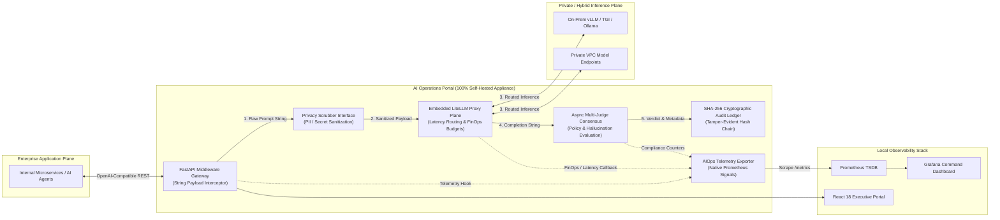

# AI Operations Portal (`ai-operations-portal`)

## Architectural Executive Overview

**AI Operations Portal** is a **100% self-hosted, cloud-agnostic, downloadable enterprise appliance** and Universal Command Center designed to monitor, govern, and optimize production AI pipelines. Engineered specifically for strict deployment inside **private network perimeters, standalone Docker/Podman containers, and air-gapped Kubernetes environments (K3s / Red Hat OpenShift)**, the platform operates with zero external SaaS dependencies or third-party telemetry leaks.

By design, `ai-operations-portal` **does not manage underlying hardware, GPU clusters, or infrastructure provisioning**. Instead, it acts as a high-throughput, low-latency **Application-Layer Governance Middleware** that intercepts raw string payloads (inbound prompts and outbound model completions) routed through an embedded **LiteLLM proxy plane**, bridging the gap between raw text generation and enterprise operational reliability (**AIOps, FinOps, Data Sovereignty, and Cryptographic Compliance**).

---

## Core Operational Pillars

### 1. FinOps & Autonomous Cost Governance
- **Granular Token Accounting**: Intercepts and calculates real-time prompt/completion token consumption across heterogeneous LLM backends (local vLLM/Ollama endpoints, private OpenAI-compatible gateways, or hybrid inference pools).
- **Dynamic Budget Enforcement**: Enforces hard and soft ceiling budgets per tenant, department, or application key with automated fallback routing before cost overruns occur.
- **Latency-Aware Model Routing**: Leverages the embedded LiteLLM routing plane to dynamically shift traffic to the most cost-effective and lowest-latency model endpoint meeting SLA thresholds.

### 2. Data Sovereignty & Zero-Trust Privacy
- **In-Transit Payload Sanitization**: Inspects application-level string payloads prior to upstream model dispatch, ensuring sensitive corporate intellectual property, PII, credentials, and regulated entities never leave the private network perimeter.
- **Deterministic Token Vaulting & Re-Hydration**: Supports bidirectional pseudonymization markers so downstream business applications receive coherent responses without exposing raw identifiers to inference engines.
- **Air-Gapped Residency Guarantee**: All scrubbing, policy evaluation, and caching occur strictly in-memory or within local perimeter storage volumes.

### 3. AIOps Telemetry & Pipeline Observability
- **Native Prometheus Exposition**: Exports high-cardinality operational metrics (`/metrics`) including Time-To-First-Token (TTFT), end-to-end request latency histograms, token throughput rates, active concurrency gauges, and upstream provider failure ratios.
- **Runtime Process & Saturation Signals**: Correlates application-layer LLM pipeline performance with container-level memory, CPU, and file-descriptor saturation via `psutil` instrumentation.
- **Turnkey Grafana Dashboards**: Ships with pre-wired Prometheus scraping rules and Grafana visualization provisioning for immediate NOC/SOC visibility.

### 4. Cryptographic Audit Trails & Multi-Judge Governance
- **Asynchronous Multi-Judge Consensus**: Evaluates prompt/completion pairs against hallucination, toxicity, prompt-injection, and regulatory compliance policies using an asynchronous multi-judge voting architecture that avoids blocking critical-path inference latency.
- **SHA-256 Tamper-Evident Chaining**: Records every intercepted transaction, scrubbing action, and compliance verdict into an immutable hash-chained ledger (`prev_hash + payload_digest + timestamp`), providing mathematically verifiable non-repudiation for internal auditors and external regulators (SOC2, ISO 42001, EU AI Act, HIPAA).

---

## System Architecture & Data Flow Blueprint



---

## Repository Structure

```text
ai-operations-portal/
├── backend/
│   ├── src/
│   │   ├── __init__.py
│   │   ├── main.py                  # FastAPI core engine entry point
│   │   ├── privacy_scrubber.py      # Abstract interface for universal data sanitization
│   │   ├── compliance_judges.py     # Mock shell for asynchronous multi-judge consensus
│   │   ├── aiops_metrics.py         # Exposing system signals natively to Prometheus
│   │   └── audit_ledger.py          # Abstract layer for SHA-256 tamper-evident chaining
│   ├── config.yaml                  # LiteLLM routing, budgets, and Prometheus settings
│   └── requirements.txt             # Minimal backend dependencies
├── frontend/
│   ├── src/
│   │   ├── components/              # Placeholders for Dashboard, Security, and Compliance views
│   │   ├── App.jsx                  # Main single-page application entry point
│   │   └── main.jsx
│   └── package.json                 # Standard React 18 + Tailwind CSS blueprint
├── deploy/
│   └── docker-compose.yml           # Turnkey orchestration: App + Prometheus + Grafana dashboard
└── README.md                        # Master production-grade executive documentation
```

---

## Deployment Topologies

1. **Docker / Podman Perimeter Appliance**:
   ```bash
   cd deploy && docker-compose up -d
   ```
2. **Air-Gapped Kubernetes (K3s / Red Hat OpenShift)**:
   - Stateless FastAPI + LiteLLM control plane pods mount `backend/config.yaml` via Kubernetes `ConfigMap`.
   - Compatible with restricted OpenShift Security Context Constraints (`non-root`, read-only root filesystem, zero outbound internet egress required).

---

## Enterprise Extensions

This repository provides the **Open-Core Appliance Skeleton**, including the public FastAPI interceptor gateway, native Prometheus AIOps telemetry hooks, agnostic LiteLLM FinOps configuration, and executive UI shell.

To maintain strict security boundaries and protect proprietary algorithms, the **core processing logic (Universal Scrubbers, real multi-judge engines, and secure ledgers) is managed via private enterprise R&D configs**:

- **Universal Context-Aware Scrubbers (`privacy_scrubber.py`)**: High-speed NER/regex-hybrid sanitization engines, domain-specific financial/healthcare redaction ontologies, and reversible cryptographic token vaults.
- **Production Multi-Judge Consensus Engines (`compliance_judges.py`)**: Calibrated small-language-model (SLM) judge ensembles, deterministic guardrails, and sub-15ms asynchronous policy arbitration.
- **Hardware-Backed Secure Ledgers (`audit_ledger.py`)**: HSM-signed Merkle trees, WORM storage sinks, and automated regulatory compliance attestation exporters.

> **Discussions**:  
> Organizations requiring production access to private enterprise R&D configurations, custom multi-judge compliance rulepacks, or dedicated air-gapped K3s/OpenShift deployment engineering are invited to **contact the author**.

